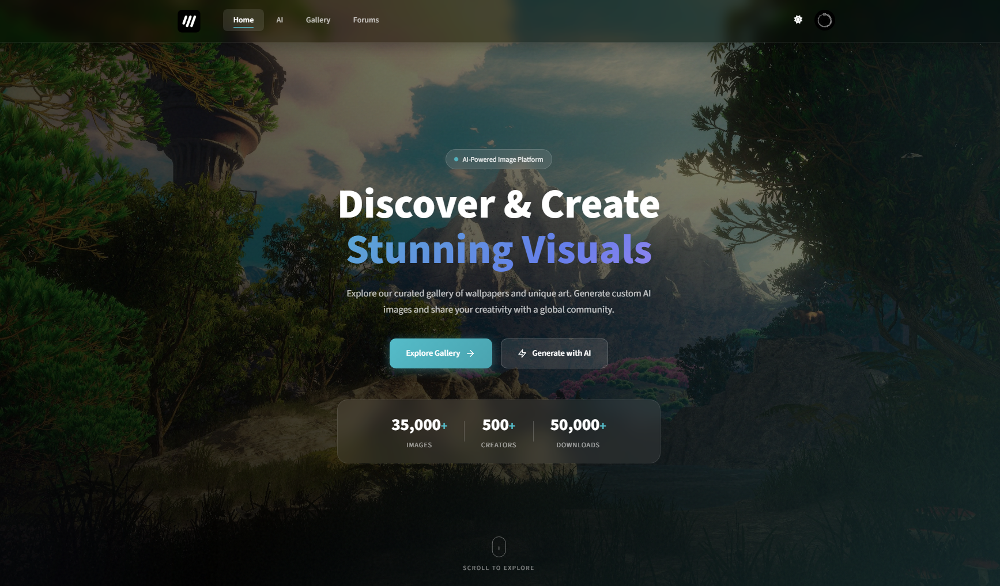
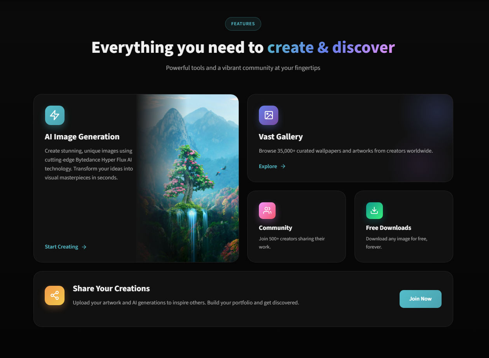
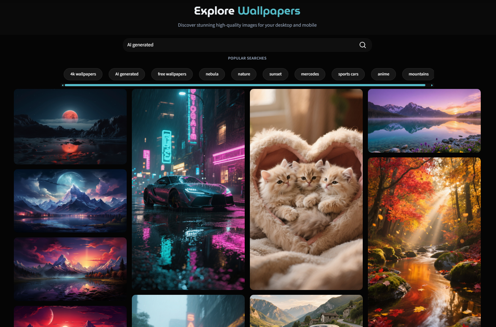
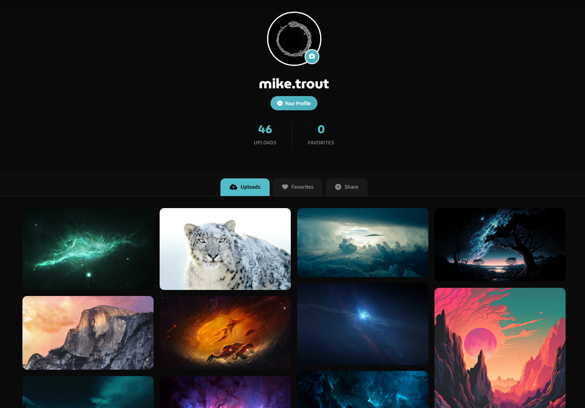
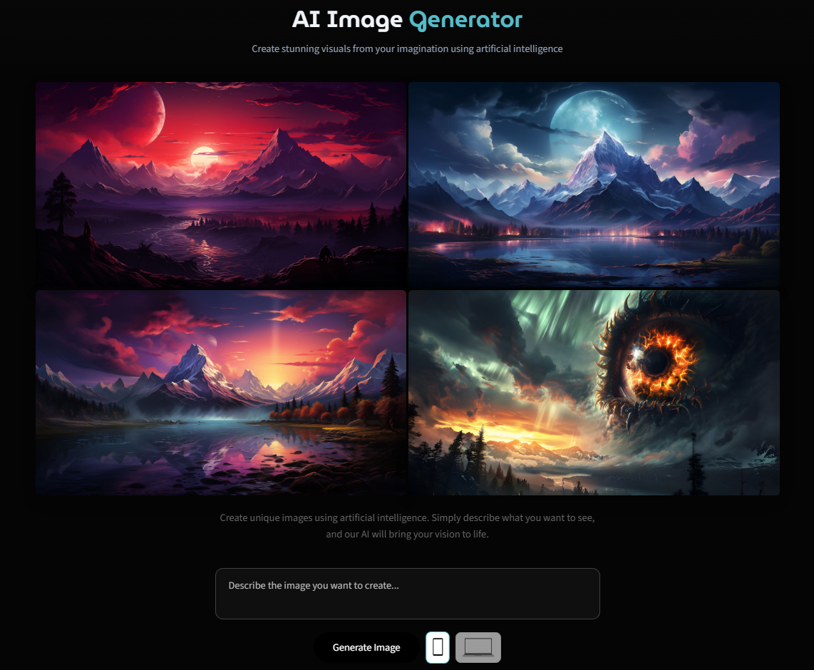

# Scenary

I built this app was originally for a client and maintain it here as a local fork. I recently updated the UI to modernize the look and improve mobile behavior. Original Version can be viewed here https://github.com/liamCarra/wall-application-OS

## Features

- User accounts with basic profile customisation
- Image uploads and gallery browsing
- Favorites / save images
- Simple forums / threads (support)
- AI image generation interface (generates wallpapers in different aspect ratios)
- Responsive UI with dark mode support
- Image download and sharing actions

## Bulk image import

Place images in `image_import/images/` and add a row for each image to
`image_import/manifest.csv`. The CSV must have `filename` and `keywords` columns;
put comma-separated keywords in quotes, for example:

```csv
filename,keywords
black-cat.webp,"cat, black cat, animal"
honda.jpg,"car, honda, automobile"
```

From the `src` directory, validate the batch first, then import it. Add
`--username YOUR_WALLIFY_USERNAME` if you want the images associated with an
existing account; omit it to leave them unlinked:

```powershell
python manage.py import_images --dry-run
python manage.py import_images
```

The command converts images to JPEG, uploads them under unique filenames in the
S3 `images/` folder, and stores each image key and its keywords in Postgres.
The local `image_import/` folder is git-ignored. Only files listed in the CSV
are imported. `image_import/import_results.csv` records the import state, so a
rerun skips completed files and retries failed or interrupted ones.

## Screenshots

Below are a few screenshots of the app UI (stored in `src/app/static/images/ui/`). Click any image to view it full-size on GitHub.

- Home (hero):

	

- More Home:

	

- Gallery:

	

- Profile:

	

- AI Generator:

	
